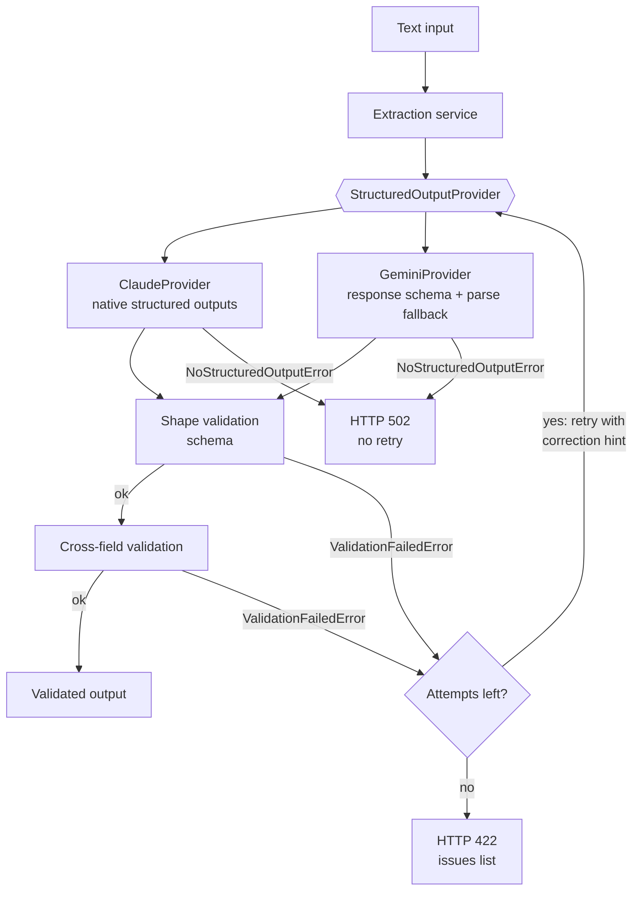

# AI Platform Architecture

A service that turns free-form natural language into validated, structured data via LLM providers.

Built from 5 design documents written before any code, including 30 binding engineering principles.

## Architecture

Monorepo, npm workspaces for the TypeScript packages, `uv` for the Python package.

```
packages/
├── contract/               # TypeScript — the shared output schema (Zod), inferred types,
│                           #   and cross-field validators
├── extraction-service/     # TypeScript — provider abstraction, retry, Claude + Gemini providers
└── extraction-service-py/  # Python port of extraction-service (Pydantic models, same
                            #   validators, same providers) + a FastAPI HTTP endpoint
```

The service never talks to an LLM SDK directly. It depends on one interface,
`StructuredOutputProvider`, and each provider decides how to get structured output out of
its own API. Validation runs in two stages, because a schema can't express every rule:

1. **Shape** — the provider returns an instance of the requested schema, or raises.
2. **Cross-field** — rules that span the whole document (duplicate IDs, references to IDs
   that were never declared, ordering of history entries).



## Key code

Excerpts are from the Python package, copied as-is. Cuts are marked with `# ...`
(docstrings and imports removed for length).

### 1. Provider interface and one implementation

`providers/base.py`

```python
@dataclass(frozen=True)
class GenerateParams[T: BaseModel]:
    system: str
    input: str
    schema: type[T]


@runtime_checkable
class StructuredOutputProvider(Protocol):
    async def generate[T: BaseModel](self, params: GenerateParams[T]) -> T: ...
```

`providers/claude_provider.py`

```python
class ClaudeProvider:
    # ...
    async def generate[T: BaseModel](self, params: GenerateParams[T]) -> T:
        response = await self._client.messages.parse(
            model=self._model,
            max_tokens=self._max_tokens,
            system=[
                {
                    "type": "text",
                    "text": params.system,
                    "cache_control": {"type": "ephemeral"},
                }
            ],
            output_format=params.schema,
            messages=[{"role": "user", "content": params.input}],
        )

        if response.parsed_output is None:
            raise NoStructuredOutputError(
                "Claude produced no structured output "
                f"(stop_reason: {response.stop_reason})."
            )

        return response.parsed_output
```

The interface is generic over a Pydantic model and says nothing about tools or function
calling. Claude uses native structured outputs. Gemini uses a response schema and falls back
to parsing the text body. Callers can't tell which one is in use. The system prompt is marked
for prompt caching because it is the same on every call.

### 2. Retry with error categorization

`errors.py`

```python
class ExtractionError(Exception):
    pass


class ValidationFailedError(ExtractionError):
    """Thrown when the provider's output fails schema or domain-rule validation."""

    def __init__(self, issues: list[str]) -> None:
        self.issues = issues
        # ...


class NoStructuredOutputError(ExtractionError):
    """Thrown when the provider returns no usable structured output at all."""
```

`retry.py`

```python
@dataclass(frozen=True)
class RetryContext:
    attempt_number: int
    previous_error: Exception | None = None


async def with_retry[T](
    attempt: Callable[[RetryContext], Awaitable[T]],
    *,
    max_attempts: int = 2,
    should_retry: Callable[[Exception], bool] = lambda _: True,
) -> T:
    previous_error: Exception | None = None

    for attempt_number in range(1, max_attempts + 1):
        try:
            context = RetryContext(
                attempt_number=attempt_number, previous_error=previous_error
            )
            return await attempt(context)
        except Exception as error:
            previous_error = error
            if attempt_number >= max_attempts or not should_retry(error):
                raise

    raise AssertionError("unreachable: loop always returns or raises")
```

Call site, inside the service's per-attempt closure:

```python
            correction_hint = (
                "; ".join(context.previous_error.issues)
                if isinstance(context.previous_error, ValidationFailedError)
                else None
            )

            extraction = await self._provider.generate(
                GenerateParams(
                    system=SYSTEM_PROMPT,
                    input=build_user_message(text, correction_hint),
                    schema=LlmExtraction,
                )
            )
            # ...

        return await with_retry(
            attempt,
            max_attempts=self._max_attempts,
            should_retry=lambda error: isinstance(error, ValidationFailedError),
        )
```

The retry helper hands the previous exception to the next attempt, so a retry is not a blind
repeat. On a validation failure the exact issues go back to the model as a correction hint.
Only `ValidationFailedError` is retried. An empty response (`NoStructuredOutputError`) fails
immediately, because sending the same request again usually gives the same result. The HTTP
layer maps the two errors to 422 and 502.

### 3. Unit test with a mocked provider client

`tests/providers/test_claude_provider.py`

```python
class _Dummy(BaseModel):
    value: str


def _provider_with_mocked_response(
    parsed_output: _Dummy | None, stop_reason: str = "end_turn"
) -> ClaudeProvider:
    provider = ClaudeProvider(api_key="test-key")
    response = MagicMock(parsed_output=parsed_output, stop_reason=stop_reason)
    provider._client.messages.parse = AsyncMock(return_value=response)  # type: ignore[attr-defined]
    return provider


def test_generate_returns_parsed_output() -> None:
    provider = _provider_with_mocked_response(_Dummy(value="ok"))
    result = asyncio.run(
        provider.generate(GenerateParams(system="s", input="i", schema=_Dummy))
    )
    assert result.value == "ok"


def test_generate_raises_when_parsed_output_is_none() -> None:
    provider = _provider_with_mocked_response(None, stop_reason="max_tokens")
    with pytest.raises(NoStructuredOutputError, match="max_tokens"):
        asyncio.run(
            provider.generate(GenerateParams(system="s", input="i", schema=_Dummy))
        )
```

The suite makes no network calls. Provider tests mock the SDK client at the single method the
provider calls. Service tests use a `FakeProvider` that validates its canned responses against
the requested schema, so validation errors fire in tests exactly where a real provider would
raise them. A truncated response (`stop_reason: max_tokens`) has its own test.

## Verified

Results from a local run of the Python package (`extraction-service-py`):

| Check | Command | Result |
|---|---|---|
| Tests collected | `pytest --collect-only -q` | 160 tests across 24 test modules |
| Test run | `pytest -q` | 160 passed, 0 failed (1 deprecation warning from a third-party test client) |
| Static types | `mypy --strict` (scope: `src/`) | `Success: no issues found in 27 source files` |
| Lint | `ruff check` | `All checks passed!` |

Git history:

- Repository: 36 commits. The design documents were committed before the first line of code.
- Python port: 14 commits, built bottom-up (scaffold → models → validators → providers →
  service → HTTP endpoint → docs). Every code commit either includes tests or comes right
  after a test-only commit for the same layer.

The TypeScript packages are compiled with `"strict": true` and tested with `node:test`.

## Tech stack

- **Python 3.12**: Pydantic v2, FastAPI, `anthropic` and `google-genai` SDKs, pytest, mypy
  (strict), ruff, uv
- **TypeScript 5.9** (strict): Zod 4, `@anthropic-ai/sdk`, `@google/generative-ai`, `node:test`,
  ESLint, Prettier, npm workspaces
- **LLM providers**: Claude (native structured outputs), Gemini (response schema)

## Roadmap

- An orchestration layer above the extraction service, plus more services that consume the
  same validated output schema.
- One shared fixture suite run against both the TypeScript and Python implementations in CI.

## Code access

Source is private. Read access available on request — giu.bracale@gmail.com

---

© 2026 Giuseppe Bracale — All rights reserved.
